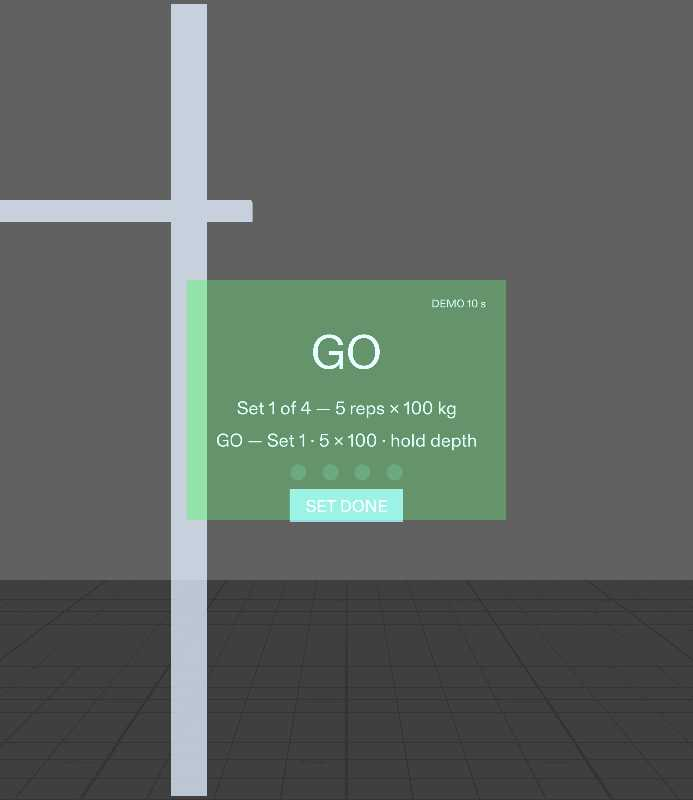
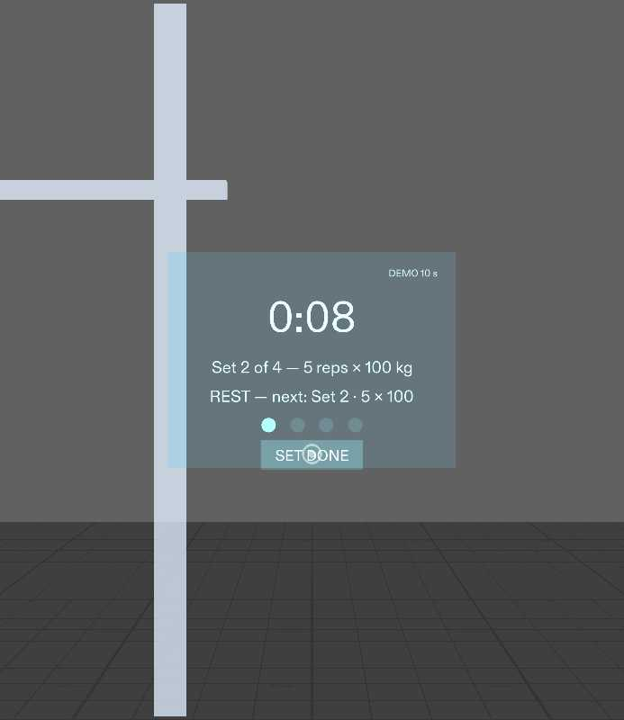
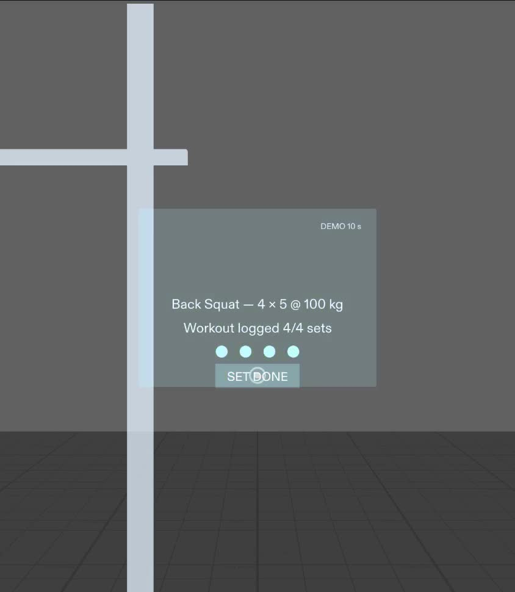

# Rest-Set Coach: a rally co-driver for the squat rack

A Lens for Snap SPECS, built for **Learn AR with SPECS** (Devpost, Nov 2026). The next set stands at the rack and calls you in like a pace note, **"GO — Set 2 · 5 × 100 · hold depth"**, and one pinch on **SET DONE** logs the set and starts the rest.

| GO | REST | DONE |
|---|---|---|
|  |  |  |

## Flow
GO (green, pace note) → pinch SET DONE → dot fills, 10 s rest countdown (amber READY at 3 s) → GO for the next set → … → after set 4: "Workout logged 4/4 sets".

## Repo layout
- `lens-project/`: the Lens Studio 5.23.2 project (`RestSetCoach.esproj`). Open it in Lens Studio and press Preview.
  - `Assets/Scripts/RestSetCoach.ts`: the whole Lens logic.
  - `Assets/Tests/`: 5 LEAF scenarios plus `LeafIndex.ts`.
  - `Packages/`: Spectacles Interaction Kit, UI Kit and LEAF 2.0.2.
- `devpost/design-brief.md`: the plan-lens design brief (approved).
- `lens-src/`: portable scripts, tests and `SETUP.md` (how to rebuild the scene by hand).
- `docs/LEAF_RESULTS.txt`: test runs. 5/5 pass in the preview; see the note on `rest_countdown_runs`.
- `docs/DEVPOST_SUBMISSION.md`: write-up and disclosures.

## Built with
Lens Studio 5.23.2 (SPECS Base Template), Spectacles Interaction Kit 0.18, LEAF 2.0.2, the Lens Studio MCP, the learn-specs `plan-lens` skill, and the CLAD (`ls-clad`) files as reference. Built and previewed under Wine on Linux (CPU rendering).

## Honest notes
- `rest_countdown_runs` timing tolerance was loosened (any "0:xx" first reading, start above 8 s) after flaky failures under Wine.
- Pinches in the demo video are mouse/touch input in Interactive Preview. Not tested on a SPECS device.
- LEAF 4.0 needs a newer interaction kit than this template has, so LEAF 2.0.2 is used.

MIT licensed. Dual use: the Mission Winning "log a set" prototype, and a reusable Learn AR template.
